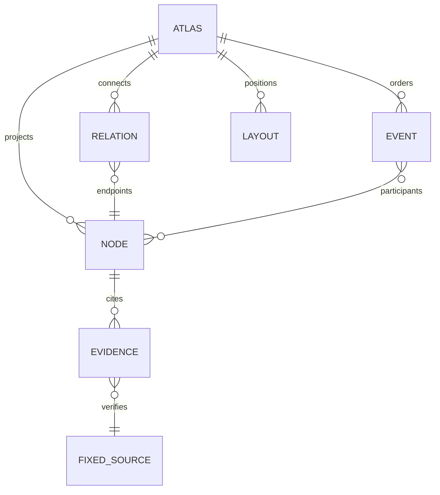

# 数据与 API 设计

插件ID为`org.wordflowlab.novel-atlas`，专业类型`novel_atlas`，数据版本1。根字段为format_version、title、nodes、relations、events、layout。source_refs归宿主管理，聚合内只使用source_index，不更换旧索引。

| 结构 | 字段与不变量 |
| --- | --- |
| Node | id、name、kind、summary、status、evidence、attributes；kind为character/group/location/item/concept，status为extracted/planned/canonical_projection |
| Attribute | key、value；只保存专业投影，不代替宿主正式设定 |
| Relation | id、from、to、kind、summary、evidence；端点必须存在，允许不同阶段的多关系，不允许悬空 |
| Event | id、title、summary、participants、story_time、narrative_order、evidence；story_time为文本或null，不推造日历；叙事顺序为非负整数 |
| Layout | node_id、x、y；有限坐标，只描述投影布局 |
| Evidence | source_index、byte_start、byte_end、quote；文稿引文按UTF-8半开区间核对；设定证据由固定实体引用与摘要表述 |

动作统一经hetu.plugins.invoke：list_projects/get_project/save_project、put_node/remove_node、put_relation/remove_relation、put_event/remove_event、set_layout、project_blueprint、get_projection、get_source、compare_versions、export_project、get_operation。

project_blueprint只读返回明确实体的节点候选，保存另行CAS执行。remove_node在关系、事件或布局仍引用时拒绝，调用者先明确处理依赖。get_projection按人物、关系、地点、时间线、属性、器物过滤同一聚合，未筛选数据不丢失。

新建CAS为0与空摘要，更新为确切对象/修订/sha256。来源只追加，专业ID唯一，来源越界和引文不符拒绝。导出固定版本，JSON/Markdown/HTML使用分块UTF-8输出与内容摘要；HTML完整离线并转义恶意标题、引文和脚本闭合。
