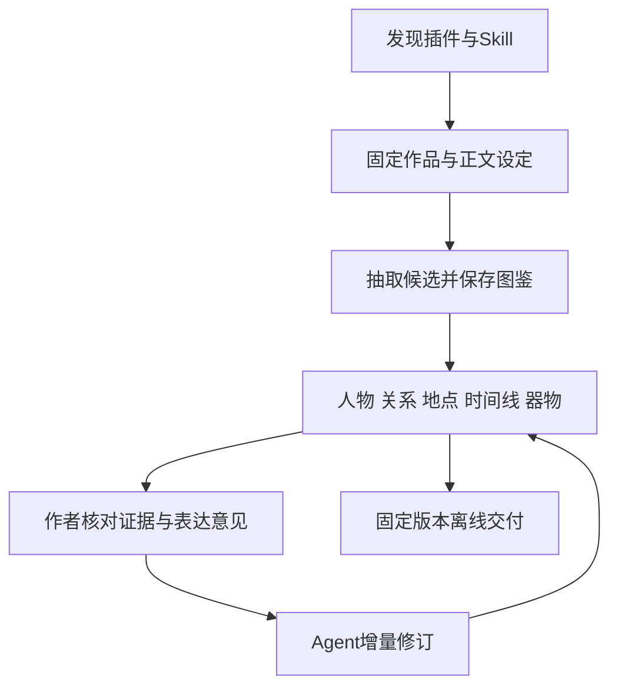

# 用户用例与验收

| 用例 | 预期与测试层 |
| --- | --- |
| NAU-01 原创作品空图鉴 | 空状态说明下一步；单元/机器/UI |
| NAU-02 已有小说整书/分批抽取 | 记录实际来源范围，不宣称未读章节；机器 |
| NAU-03 正式人物设定投影 | 固定实体与canonical_projection；机器 |
| NAU-04 推测角色关系 | extracted明确且有据，不改正式设定；单元 |
| NAU-05 多方向多阶段关系 | 保留关系种类，不只以端点去重；单元/UI |
| NAU-06 删除被引用角色 | 拒绝悬空引用，保留原数据；单元/机器 |
| NAU-07 顺叙倒叙插叙 | 叙事顺序与故事时间独立；单元/UI |
| NAU-08 未知时间地点 | null或无布局，不显示假地理；单元/UI |
| NAU-09 成长与情感 | 同数据属性及事件投影；单元/UI |
| NAU-10 器物转移 | 多事件保留持有者变化依据；单元 |
| NAU-11 跨作品或错误摘要 | 宿主拒绝；真实机器 |
| NAU-12 引文UTF-8越界 | 拒绝且不替换原数据；单元/机器 |
| NAU-13 同键重放/异输入 | 同结果/冲突；机器 |
| NAU-14 CAS冲突/响应丢失 | 保留输入/原键回读；单元/机器 |
| NAU-15 关闭后重新打开 | 固定对象仍可读取；Electron |
| NAU-16 停用再启用 | 停止调用/重新发现恢复数据；机器 |
| NAU-17 卸载重装 | Skill退出/数据保留恢复；机器 |
| NAU-18 离线恶意内容导出 | 无执行注入、无网络、全文不默认外带；单元/浏览器 |
| NAU-19 窄窗浅暗与键盘 | 不溢出，筛选和证据可达；浏览器/Electron |
| NAU-20 与规划文风审校接续 | Agent经各自公开动作转交固定依据，无私有目录穿透；机器 |

正式包重新下载后的安装验收独立取证。单元通过不代替当前安装版，也不代替Windows。

## 长篇专业深化

新增能力及兼容合同见[10-专业深度与升级验收](10-专业深度与升级验收.md)。字段以包清单Schema为准，专业动作与Skill由同包生成清单导航，实施及实际验证由08维护。
