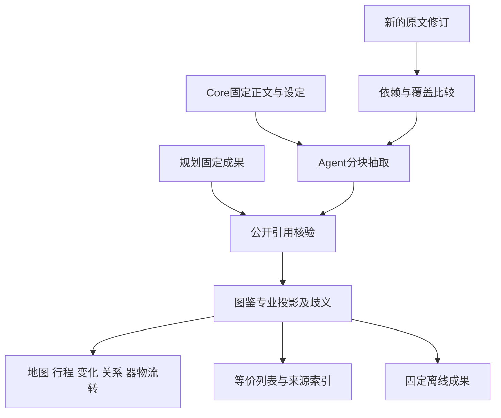
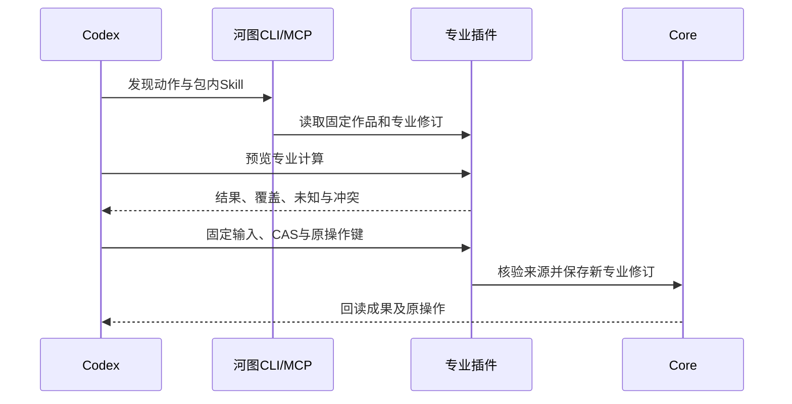

> 本文属于[小说图鉴文档](README.md)，定义专业深化合同；基础格式见[03](03-数据与API设计.md)。

# 专业深度与升级验收

## 1. 现状与目标

v0.1.0已有同源实体、关系SVG、地点列表、事件时间线、属性投影和离线HTML。静态审计核对`src/domain/model.ts`、`src/application/project.ts`和`src/view/index.tsx`：地点尚非地理地图，`growth`返回属性及事件，尚无成长时间序列曲线。独立感情线、整书阅读联动和增量抽取覆盖也需深化。

图鉴的专业价值是让作者从同一份有据资料看到人物、空间、时间和变化，并回到原文。视图必须表达真实专业结构，不能只换标题或把列表称为地图。正式设定、正文和作者意见继续归宿主，规划状态归规划Owner，本插件拥有可重建投影、布局和抽取记录。

参考Novel Atlas的多视图、cong7781/novel的分块恢复、character-profiler的人物出场统计及jizuo-memory的来源组织；固定研究由河图插件29维护。当前采用依据见[09](09-调研依据与设计决策.md)与[研究清单](research-sources.json)。

## 2. 专业结构与视图

以下专业结构由可选 `depth.version=1` 承载；具体字段以包清单Schema为准。

| 结构 | 最小字段及约束 | 主要视图 |
| --- | --- | --- |
| PlaceGeometry | 地点引用、示意／坐标／拓扑类型、坐标系及可选单位、父空间、来源 | 世界／区域／建筑示意图；未知位置独立列表 |
| RouteSegment | 明确人物或队伍、起止地点、故事定位、移动依据、可选耗时和距离 | 分章节／事件的行程；未知距离不补直线值 |
| AttributeObservation | 实体、属性、事件或固定原文位置、数值／有序等级／文本、单位与证据 | 数值曲线、有序阶段或文本变化表 |
| RelationObservation | 端点、关系类型、有效事件范围、叙述视角、证据及可选显式量表 | 关系阶段、感情线和等价表格 |
| ItemTransfer | 物品、转出／转入实体、事件、流转类型与依据 | 器物流转链及持有状态 |
| Appearance | 实体、固定文稿范围、提及／实际出场／视角类型及抽取说明 | 出场轨迹、人物阅读索引 |
| ExtractionRun | 固定分块清单、输入摘要、完成／失败／未读、抽取版本与歧义 | 增量覆盖与重做范围 |
| ProjectionManifest | 固定图鉴及输入引用、筛选和布局、视图版本、离线文件清单及摘要 | 可复现多视图和完整交付 |

专业实体ID不替代宿主正式实体引用。别称与同名需显式映射，歧义保留多候选；跨作品同ID也不能合并。抽取、作者规划、正式来源投影分别展示，不能把计划中的婚姻、死亡或物品归属显示为已经发生。

属性没有通用强制评分。“信任转为怀疑”可以是定性阶段；只有来源或作者明确选择量表时才画数值曲线。不同境界体系不能擅自换算成战斗力。关系方向、单向误解和不可靠叙述分别记录。

## 3. 分层和增量更新

普通TypeScript负责专业校验与投影，React／SVG负责交互渲染，公开SDK负责存取。先使用现有渲染栈，不为静态地图引入GIS服务；关系规模和真实交互需求超出当前能力时再评估图布局库。地理坐标、UI布局及时间定位分别存储，不能共用`x/y`冒充三种含义。

分块先固定完整范围清单，再逐块保存结果；目录存在不表示已读。新稿产生时比较输入摘要和依赖，只标记受影响的投影为待复核，不自动覆盖旧抽取，也不宣称未受直接影响的语义结论一定正确。跨章关联需扩展复核范围；断点、失败及歧义均可回读。

插件间只经公开固定引用接续，核对规划对象、修订和摘要。当前SDK不能承载具体固定来源时，先登记最小宿主缺口，不导入另一个插件的内部模块或直读受管文件。故事时间以规划明确语义为依据，文本标签不用于计算真实间隔。

## 4. API与兼容

正式动作以当前包清单及实际能力发现为准。

| 拟议动作 | 效果与用途 |
| --- | --- |
| `put_place_geometry`／`put_route_segment` | managed_write；保存明确空间类型和行程证据 |
| `put_observation` | managed_write；按类型保存属性、关系或器物流转，不修改正式设定 |
| `put_extraction_run` | managed_write；保存固定覆盖、分块结果引用与失败记录 |
| `preview_projection_update` | read；比较新旧固定输入，返回影响、歧义和建议重做范围 |
| `get_projection_bundle` | read；固定同一修订生成多视图、等价表格、来源索引和完整性说明 |

现有`get_projection`及v1对象保持原义；新增字段采用明确格式版本或可选结构，实施时先定迁移合同。旧`layout`只转换为UI布局，不推断真实坐标；旧`attributes`缺少时间点时保持属性表，不伪造成历史曲线。旧事件和固定引用原样保留，迁移通过新修订完成。

宿主CAS、来源核验及原键恢复继续生效。重建布局不改变事实，重建投影不等于更新正式设定。移除实体前核对关系、行程、观测与覆盖依赖，不能留悬空边或静默级联删除全部历史。

离线导出固定图鉴修订和筛选条件，包含各视图及等价数据。默认只交付必要引文与来源说明，不隐含整书正文。大数据分页或分块应有完整清单与摘要；不存在可回读范围时显示不可用，不展示假空图。HTML继续转义数据，不载入远程脚本或自动发布到外网。

## 5. 作者旅程与验收

作者可以说：“看这十章的行程与关系变化，把不确定的地方指出来。”Codex固定阅读范围，分块抽取并保存专业数据，作者回来查看地图、关系阶段和依据；提出意见后，Agent只更新明确范围。画布拖拽和坐标录入均非必经步骤。

下列用例由深化测试承接，实际通过范围由08及固定回执记录。

| ID | 输入或反例 | 必须证明 |
| --- | --- | --- |
| NAD-01 | 只有地点名称，没有坐标 | 提供拓扑／列表与未知状态，不画成真实地理 |
| NAD-02 | 已知坐标、不同空间、同名地点 | 坐标系与单位分开，父子空间及引用明确 |
| NAD-03 | 两地点间只有“数日后到达” | 保留区间或文本，不伪造距离、速度和精确日期 |
| NAD-04 | 数值成长、定性境界及退步事件 | 曲线、阶段表各自适用，单位和出处可读 |
| NAD-05 | 单向感情、误解与未来关系规划 | 方向、视角、阶段和计划事实分开 |
| NAD-06 | 物品赠予、借还、同名物与销毁 | 按明确物品引用显示流转，未知持有人保持未知 |
| NAD-07 | 人物被提及、实际登场、伪装与化名 | 区分计量类型；别名候选不自动合并 |
| NAD-08 | 二十章只读五章，中途失败再恢复 | 覆盖真实、分块可回读，未读不记为抽取完成 |
| NAD-09 | 只改一章，但改变人物身份 | 标记直接及关联影响，保留旧投影，不假称其余全部有效 |
| NAD-10 | 图鉴引用固定规划，规划产生新修订 | 旧图不漂移；显式准备更新并核对影响 |
| NAD-11 | 切换地图／关系／属性／阅读入口 | 同一固定修订和筛选，图表、表格与来源能相互定位 |
| NAD-12 | 恶意标签、离线断网、大量节点及键盘操作 | 输出可读可导航，不执行内容；密集图有列表回退 |
| NAD-13 | 旧v1对象升级、来源撤权、CAS及unknown | 不推造缺失字段；失败关闭保留输入，原键恢复 |

单元验证空间与观测不变量、投影稳定性、增量依赖及导出完整性；真实CLI/MCP和同一Codex会话验证读取、保存、恢复与Skill；正式包工作面分别检查实际地图、曲线、关系阶段及原文定位。Mac、Windows和Linux分别取证，不把浏览器可渲染推为跨平台业务验收。实际创作可用性和作者认可独立审阅。

## 本次实现合同

目标版本 `0.2.0`。范围为空间与行程、数值和定性变化、单向关系与器物流转、抽取覆盖与增量影响。聚合保留原 `format_version=1`，新增可选 `depth.version=1`；旧对象读取、旧动作和历史修订原义保持。仅 `save_depth` 或新的逐项写动作显式建立深化结构；读取不自动迁移，保存通过宿主CAS产生新修订。旧客户端必须拒绝未知字段，不得裁掉深化结构后覆盖。

实际字段以包清单 Schema 为唯一来源。新动作均通过原有稳定 CLI/MCP 转发；纯 TypeScript 计算专业结果，React/SVG 展示，ProjectStore 负责固定来源与原键恢复，Core 拥有作品和决定。

| 动作 | 用途 | 效果 |
| --- | --- | --- |
| `put_place_geometry` | 保存明确空间坐标 | managed_write |
| `put_route_segment` | 保存有据人物行程 | managed_write |
| `put_observation` | 保存变化与流转观测 | managed_write |
| `put_extraction_run` | 保存真实抽取覆盖 | managed_write |
| `preview_projection_update` | 预览新来源影响 | read |
| `get_projection_bundle` | 读取固定多视图与依据 | read |
| `save_depth` | 保存明确专业深化结构 | managed_write |

测试分别覆盖纯算法反例、闭合Schema、非法来源、旧格式、CAS、丢失响应、真实CLI/MCP和实际工作面。实现与发行证据只在08维护；此处不以方案代替验收。

同作品跨插件依据使用可选 `depth.basis_refs`，每项固定Owner、对象、修订与摘要；保存和 `inspect_basis` 经公开Core读取核验。不把专业引用塞进正文来源索引，不导入其他插件内部模块；旧依据不随上游更新。没有另一作品连接时不能跨作品读取。

依赖记录ID在深化聚合内唯一；同一空间使用同一模式、坐标系和单位。相同叙事位置的数值不连成假先后曲线，改用阶段表。离线HTML包含相同地图、变化、流转、覆盖与等价表格，无远程脚本。
